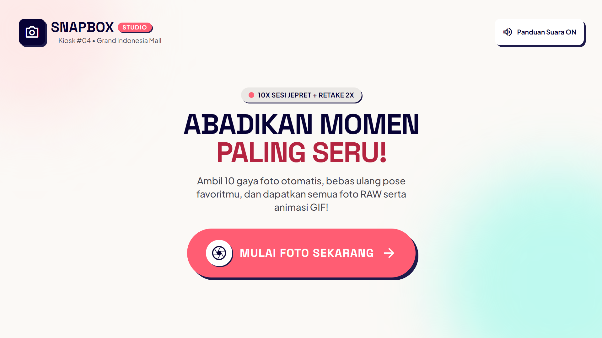
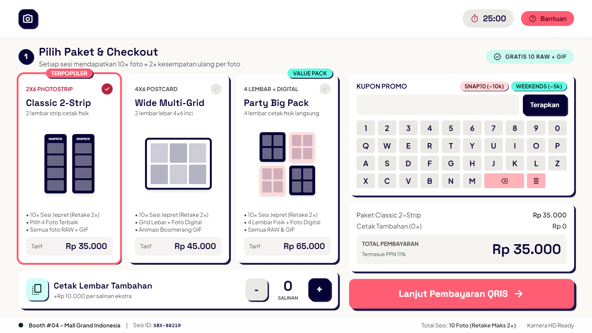
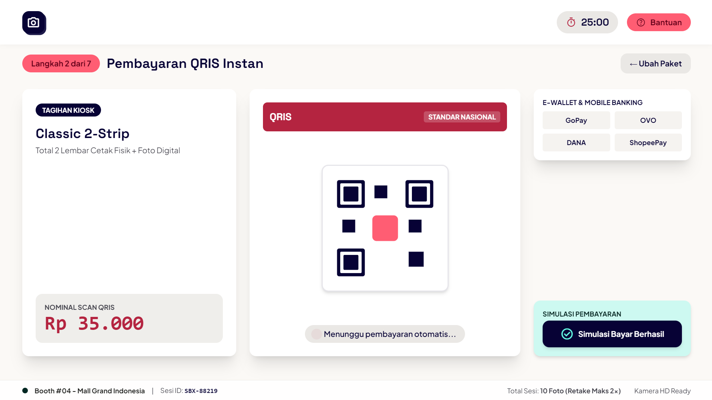
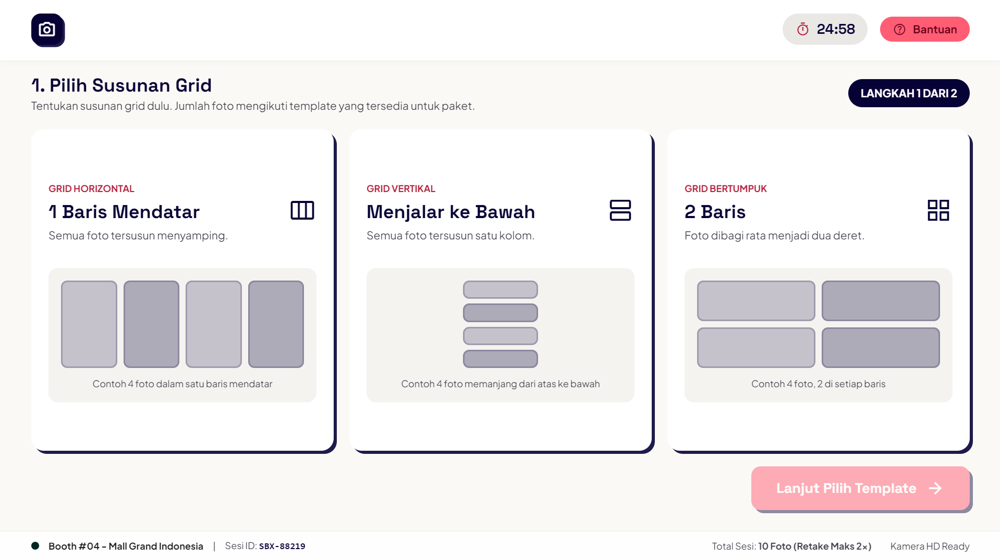
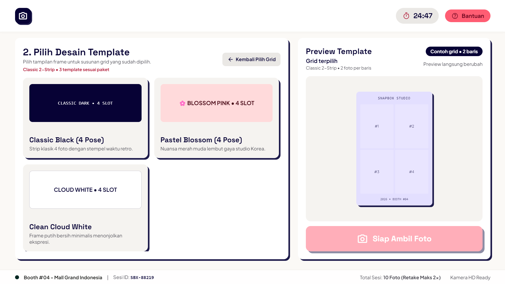
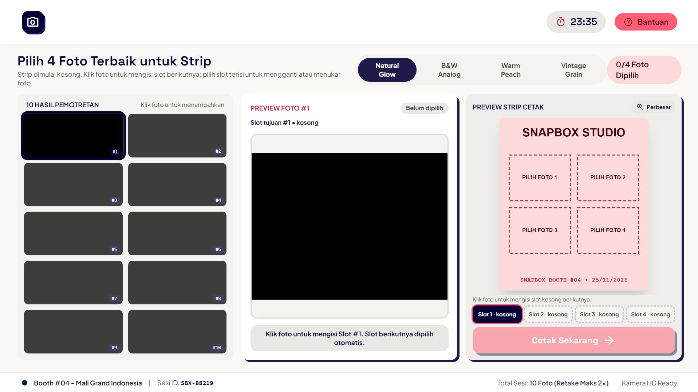
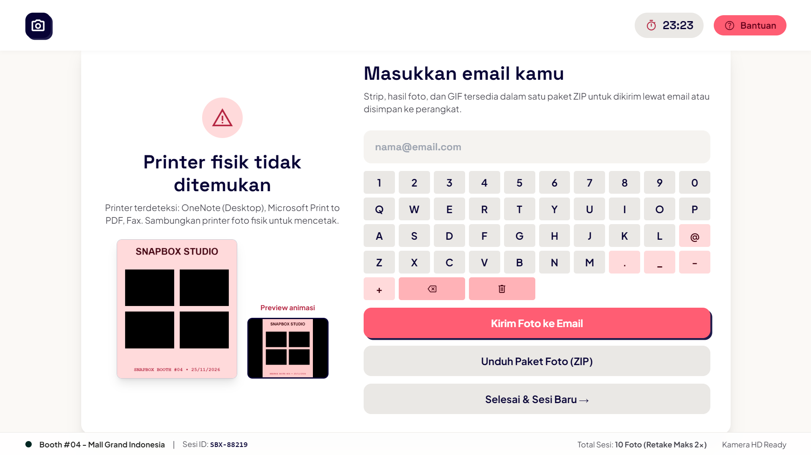

# SnapBox Kiosk

SnapBox Kiosk is an Electron photobooth application. It guides a guest through package selection, payment verification, photo capture, strip layout, printing, and email delivery of the digital files.

## Features

- Package, grid, and template selection. Available templates and photo counts depend on the selected package.
- Ten automatic photo captures, with up to two retakes for each pose.
- Photo review starts with empty strip slots. Tap photos to fill the next slot; after filling the strip, choose a slot to replace or swap its photo.
- The Classic two-row strip layout trims unused blank space so the selected photos use more of the printed area.
- Strip preview, photo filters, print progress, and physical-printer detection.
- A 25-minute session timer that starts after payment is reported successful.
- A ZIP containing the strip image, captured photos, and GIFs, available by email or local save.

## Screenshots

<table>
  <tr>
    <td align="center"><strong>Home</strong><br></td>
    <td align="center"><strong>Package checkout</strong><br></td>
  </tr>
  <tr>
    <td align="center"><strong>QRIS payment</strong><br></td>
    <td align="center"><strong>Grid selection</strong><br></td>
  </tr>
  <tr>
    <td align="center"><strong>Template selection</strong><br></td>
    <td align="center"><strong>Photo selection</strong><br></td>
  </tr>
  <tr>
    <td align="center"><strong>Email delivery</strong><br></td>
    <td></td>
  </tr>
</table>

## Requirements

- Node.js and npm
- Windows PC with a webcam and, for physical output, a supported photo printer
- Internet access and SMTP account settings for email delivery

## Run locally

From the project directory:

```powershell
npm install
Copy-Item .env.example .env
npm start
```

Edit `.env` with the SMTP settings described below before testing email delivery. Keep `.env` private; it is excluded from Git. For a packaged kiosk, put `.env` beside the application executable.

## Configure email

The kiosk sends one ZIP attachment. Its maximum compressed size is 18 MiB. Configure these values in `.env`:

| Variable | Description |
| --- | --- |
| `SMTP_HOST` | SMTP server hostname |
| `SMTP_PORT` | SMTP port, commonly `465` or `587` |
| `SMTP_SECURE` | `true` for implicit TLS (commonly port 465); `false` for STARTTLS (commonly port 587) |
| `SMTP_USER` | SMTP username; optional only if the SMTP relay permits unauthenticated sending |
| `SMTP_PASS` | SMTP password or provider-issued app password; leave blank when authentication is not used |
| `SMTP_FROM` | Authorized sender email address; defaults to `SMTP_USER` when omitted |

Example for a Gmail account using an app password:

```dotenv
SMTP_HOST=smtp.gmail.com
SMTP_PORT=465
SMTP_SECURE=true
SMTP_USER=booth@example.com
SMTP_PASS=provider-issued-app-password
SMTP_FROM=booth@example.com
```

Use an app password or SMTP credential issued by the email provider, not the account's normal sign-in password. The sender address must be allowed by the SMTP provider. Never put real credentials in `README.md`, `.env.example`, or source code.

After changing `.env`, restart the kiosk. On success, the guest sees a confirmation; configuration, connection, attachment, or delivery errors are shown without exposing SMTP credentials.

## Kiosk flow and current limitations

1. Select a package and proceed to payment.
2. The timer starts only after the payment-success action.
3. Choose a grid and a compatible template, then complete the photo session.
4. Fill the empty strip slots by tapping photos, then replace or swap photos as needed before printing.
5. Enter an email to receive the ZIP, save it locally, or finish and start a new session.

The QRIS success action is currently a simulation, not a connection to a payment provider. Connect a real payment verification service before production use. Physical printing requires an available non-virtual printer; browser preview mode does not print to hardware.

## Project layout

- `main.js` - Electron main process, printer handling, SMTP email delivery, and local ZIP saving
- `preload.js` - restricted renderer-to-main IPC bridge
- `renderer/index.html` - kiosk screens
- `renderer/app.js` - session flow, camera, photo selection, strip generation, and email UI

## Troubleshooting

- **Email configuration message:** check that `SMTP_HOST` and `SMTP_FROM` are set, and that both `SMTP_USER` and `SMTP_PASS` are either set together or left blank.
- **Email delivery failure:** verify the SMTP host, port, TLS mode, sender authorization, credentials, and network access.
- **Attachment too large:** the ZIP must be 18 MiB or smaller.
- **No physical printer:** connect and configure a physical photo printer in Windows, then restart the kiosk.
- **Camera unavailable:** allow camera access to the application and verify that the webcam is not being used exclusively by another app.
